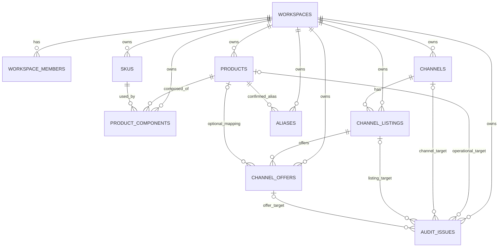
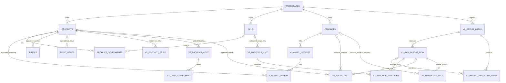
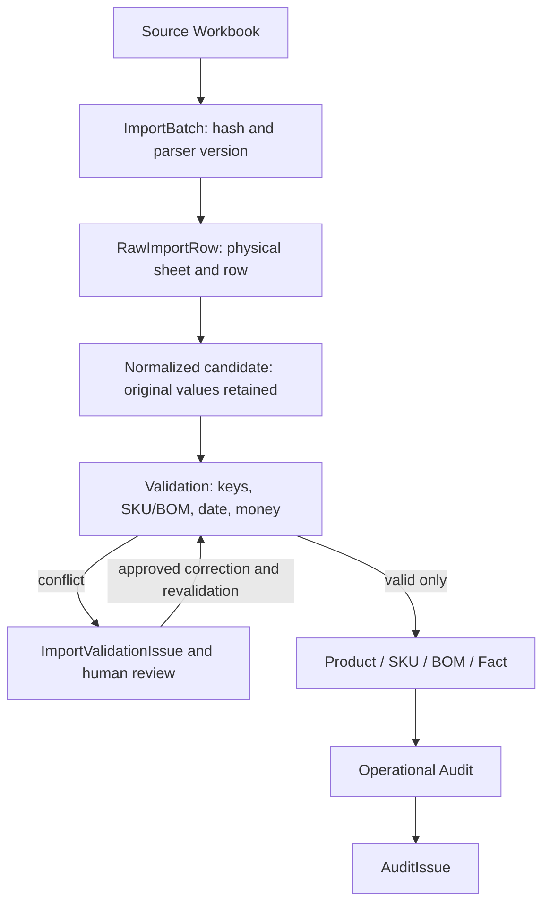

# SellerAudit Data Model V2 Proposal

상태: **설계안, 미구현**. 기준: 2026-10-24 `main` 및 [Data Dictionary v1](DATA_DICTIONARY.md). 이 문서는 테이블 생성, 기존 제약 변경, Import 계약의 확정 또는 실제 데이터 적재를 승인하지 않는다. `NEW`는 추천 모델이지 현재 DB에 존재하는 테이블이 아니다.

## 1. Executive Summary

**Recommended V2:** 현재 10개 Foundation 테이블과 Product·SKU·BOM·Listing·Offer의 의미를 유지한다. 파일 수용 경계에 `ImportBatch`, `RawImportRow`, `ImportValidationIssue`를 둔다. 검증된 행만 기존 Master에 승격한다. 별도 `LogisticsUnit`/`BarcodeIdentifier`, `ProductPrice`/`ProductCost`/`CostComponent`, 행 단위 `SalesFact`, 일·매체 단위 `MarketingFact`를 후속 단계별로 더한다. 이 설계는 원본의 불확실성을 nullable 참조와 검증 이슈로 표현하며, 파일에 없는 주문·캠페인·Product 식별자를 생성하지 않는다.

`100526` 일곱 상품의 품번 충돌은 Master에 넣기 전에 막고 `products(workspace_id, sabangnet_code)` 고유 제약을 유지한다. `AL00`은 검증 후 `skus`에 저장하며 단품과 포장 수준의 바코드는 별도 관계로 기록한다. 매출 125,242행은 값 중복을 제거하지 않고 원본 물리 행별로 보존한다. 광고는 Product FK 없이 판매 표면×일자×매체 단위로 보존한다.

## 2. Current Foundation

현재 DB의 10개 테이블은 `workspaces`, `workspace_members`, `products`, `skus`, `product_components`, `channels`, `channel_listings`, `channel_offers`, `aliases`, `audit_issues`다. `Product.sabangnetCode`는 판매상품 코드이고 `Sku.skuCode`는 실제 재고 코드다. `ProductComponent`만이 승인된 Product↔SKU 구성 관계다. Listing은 채널 상품 페이지, Offer는 구매 옵션이며 Offer가 nullable `master_product_id`로 Product에 연결된다. `P000`/`SET001`은 별도 이름 매핑 코드이며 Master 코드가 아니다. [DOMAIN.md](../DOMAIN.md), [domain.ts](../../src/types/domain.ts), [첫 Migration](../../supabase/migrations/20261009015155_seller_audit_foundation.sql)을 기준으로 한다.

현재 Product/ SKU 업무코드는 각각 Workspace 내 고유·필수다. `product_components`는 양수 수량과 Product·SKU의 동일 Workspace를 강제한다. 주요 관계는 `(workspace_id, id)` 복합 FK이며 `channels.channel_code`는 고정 enum이 아니라 문자열이다. `channel_offers.channel_option_id`의 `BASE`는 **옵션이 없는 실제 판매 단위가 확인될 때** 쓰는 기존 관례이며 옵션 행을 추측해 만들 근거가 아니다. `aliases`는 Product가 확정된 뒤 쓰는 운영 매핑 사전이다. `audit_issues`는 Product/Listing/Offer에 대한 운영 문제다. [DATABASE.md](../DATABASE.md), [후속 Migration](../../supabase/migrations/20261010064046_audit_channel_context.sql)을 기준으로 한다.

앱은 `SellerRepository`를 통해 Mock/localStorage를 사용하며 SQL DB에 연결되지 않았다. 현재 쓰기 경계는 `mapOffer`, `updateIssueStatus`이고 DB 계약은 대응 RPC다. V2 Import 쓰기는 별도 신뢰된 서비스/관리자 경계와 검증·승격 계약이 필요하다. 기존 RPC의 의미를 바꾸지 않는다. [repository.ts](../../src/services/repository.ts), [mockRepository.ts](../../src/services/mockRepository.ts), [write-boundary Migration](../../supabase/migrations/20261010080630_harden_write_boundaries.sql).

문서와 코드의 차이: [README](../../README.md)와 [FOUNDATION.md](../FOUNDATION.md)의 “사방넷 Product·SKU·BOM 원본이 아직 없음”은 채널 목록을 분석하던 당시의 상태다. Prompt 1에서 **단가표·코드DB·바코드 파일을 새로 받았지만**, 이것이 공식 사방넷 추출본 또는 승인된 SKU/BOM 원장이라는 뜻은 아니다. `상품DB!C`의 `P000`과 [SCM 분석](../SCM_SOURCE_ANALYSIS.md)의 카페24 `P000...` Listing ID도 문맥이 다르며 서로 연결하지 않는다. 현재 TypeScript와 최신 Migration 사이에 V2 Entity 구현은 없다.

추가 계약 차이: DB는 주요 코드/이름의 공백을 거부하고 `channel_option_id`의 공백을 `BASE`로 정규화하지만 Mock validator는 몇몇 필드에서 문자열 여부만 검사한다. 향후 실제 Import 검증은 DB 제약을 기준으로 맞춰야 한다. 또한 `audit_issues.channel_id`가 후속 Migration에 추가됐어도 기존 target CHECK는 Product/Listing/Offer 중 하나를 요구하므로 **Channel만** 대상인 Issue 또는 아직 Master 대상이 없는 원본 행 오류는 표현하지 못한다. 이는 ImportValidationIssue를 분리할 추가 근거다.

## 3. Source Evidence Summary

| 원본 | 확인된 사실 | V2에 주는 경계 |
| --- | --- | --- |
| [Master](MASTER_SOURCE_ANALYSIS.md), `단가표!B/F/H/R/S`, `코드DB!E`, `상품DB!E:I` | 판매상품 후보 215행; `100526`이 서로 다른 7개 상품에 반복; 품번 공백 3행; BOM 수량 불일치 8행과 `AL24` 미확인; 총원가·정상가는 snapshot 값 | 원본 행 ≠ 승인 Product. 품번, SKU, BOM, 가격·원가의 검증과 출처가 필요 |
| [Barcode](BARCODE_SOURCE_ANALYSIS.md), `단품!C/E`, `단품합포`/`단품합포카톤`, `세트구성` | `AL00 → 8809866420050`; 동일 코드 `AG001`에 합포/카톤별 바코드 2개; 바코드 393건 중 380개 고유, 전 시트 중복 13쌍 | SKU의 단일 barcode 열 또는 barcode 전역 unique 부적합. 포장 수준과 source context 필요 |
| [Sales](SALES_SOURCE_ANALYSIS.md), `로우데이터!A:G` | 125,242 물리 행, 주문/상세 ID 없음; A:G 동일값의 초과 반복 57,649행; 채널 22 label; 날짜 기준 혼재 | 물리 행 단위 Fact와 provenance 필요. 값 기반 dedupe와 강제 Product FK 금지 |
| [Advertising](AD_SOURCE_ANALYSIS.md), `자사몰!C/H:O` | 브랜드검색 13일만 유효 성과; 광고비 전부 공란; Product/상품명/캠페인 ID 없음; CTR/CVR은 %p, ROAS는 ratio 수식 | 일·표면·매체 grain. 금액/ROAS nullable, Product FK 없음, 원본 단위 보존 |

## 4. Entity Decision Matrix

`Key`는 **후보 업무키**를 가리킨다. 별도 표기가 없으면 DB 내부 PK는 UUID, 신규 업무 테이블은 `workspace_id NOT NULL`을 전제로 한다. 모든 NEW 행의 구체적인 원본 열과 기존 Entity로 표현할 때의 문제는 다음 절에 기재한다. 원본 데이터 수용을 위한 기존 업무 Entity의 물리 컬럼 변경은 추천하지 않는다. Prompt 2.1에서 별도로 결정한 `WorkspaceMember`의 Pilot 보안 확장은 §25–32에 기재한다. 신규 관계와 Import 쓰기 경계는 추후 단계에 구현한다.

| Entity / Concept | Decision | Evidence | Why | Key | Relationships | Risks |
| --- | --- | --- | --- | --- | --- | --- |
| Workspace | KEEP | 기존 SQL·Auth 계약 | 테넌트 루트 유지 | workspace UUID | 전체 Entity의 소유자 | 신뢰된 provisioning 필요 |
| WorkspaceMember | EXTEND (Pilot) | 기존 SQL·Auth 계약과 §25 | 접근 경계 유지, Role·활성 상태 추가 | `(workspace,user)` | Auth User↔Workspace | 현재 RLS/RPC는 role·status 미검사 |
| Product | KEEP | Master `단가표!B/E`; 현재 SQL | 승인된 판매상품만 저장 | UUID; `(workspace,sabangnet_code)` unique | BOM, Offer, Price/Cost | 원본 `100526` 승격 차단 |
| Sku | KEEP | `코드DB!E`, barcode `단품!C` | 검증된 실물 코드만 저장 | UUID; `(workspace,sku_code)` unique | BOM, LogisticsUnit | 코드DB 혼합 코드 유형 |
| ProductComponent | KEEP | `단가표!F/H`; 현 BOM | 승인 후에만 구성 저장 | UUID; `(workspace,product,sku)` unique | Product·Sku 복합 FK | 세트/중간코드와 수량 불일치 |
| Channel | KEEP | Sales 22 label; 현재 Channel | 판매 채널의 정규 차원 유지 | UUID; `(workspace,channel_code)` unique | Listing, optional Fact link | label 대응 미승인 |
| ChannelListing | KEEP | 채널 목록의 상품 ID | 페이지 단위 유지 | UUID; `(workspace,channel,channel_product_id)` unique | Channel→Offer | 옵션행 없는 파일 |
| ChannelOffer | KEEP | 토스 옵션 ID 179개 | 판매 단위와 nullable Product 연결 유지 | UUID; `(workspace,listing,option_id)` unique | Listing→Product | 합성 옵션 금지 |
| Alias | KEEP | 기존 수동 매핑, Master `상품DB!E:I` | 승인된 Product 매핑만 등록 | UUID; 현 source tuple unique | Product·Channel | 이름 normalization만으로 자동 승인 금지 |
| AuditIssue | KEEP | 현 운영 이슈와 RPC | Master 이후 감시 영역 | UUID | Product/Channel/Listing/Offer | Import 오류와 혼합 금지 |
| ImportBatch | NEW | 네 파일 각각에 파일명·hash·시트가 있음 | 업로드 시도, parser, 상태, snapshot 추적 | UUID; file hash는 식별 보조 | Workspace→RawRow | 재업로드 처리 필요 |
| RawImportRow | NEW | Master 행 6–220; Sales 125,242행 | 정확한 물리 행·원문 보존 | UUID; `(batch,sheet,row)` unique | Batch→Issue/Fact | 보존 기간·민감정보 관리 |
| ImportValidationIssue | NEW | `100526`, `AL24`, 날짜·금액 오류 | Master 이전 충돌/검토 상태 | UUID; issue fingerprint 후보 | Batch/RawRow; nullable 대상 없음 | 해결 승인 감사 필요 |
| LogisticsUnit | NEW | barcode `단품합포`/`단품합포카톤`의 `AG001` | 같은 코드의 포장 단위 구분 | UUID; 승인된 scope+code 후보 | 검증된 단일 Sku에만 FK | 다중 SKU 포장은 후속 검증 |
| BarcodeIdentifier | NEW | barcode `단품!E15`, 합포/카톤 바코드 | 여러 단위·중복 바코드 표현 | UUID; unit+barcode+scope 후보 | LogisticsUnit→Barcode | barcode 전역 unique 불가 |
| ProductPrice | NEW | `단가표!S`, 가격 종류 열 | 참조가격 여러 종류·채널 맥락 | UUID; source row+price_type | Product, optional Channel | 적용기간 미확인 |
| PricePolicy | DEFER | `가격DB`의 할인 band/수식 | 운영 정책 확정 전 규칙 실행 금지 | 미정 | ProductPrice 후보 | 수식 cache·의미 불확실 |
| ProductCost | NEW | `단가표!R=5940` 등 | 총원가 snapshot과 출처 | UUID; source row | Product | 포함 항목·통화 불명 |
| CostComponent | NEW | `단가표!I:N`, `O/P` 등 | 확인된 세부 원가의 종류별 행 | UUID; `(cost,component_type)` 후보 | ProductCost | 빈 셀·문자열을 0으로 오인 금지 |
| SalesFact | NEW | `로우데이터!A:G` | 물리 원본행 grain, 매출 보존 | UUID; raw_row unique | nullable Channel/Product | 주문 사실로 과장 금지 |
| SalesChannelMapping | DEFER | `로우데이터!B` 22 label | 명시적 매핑은 필요, 초기엔 승인 규칙/설정으로 충분 | source label+scope 후보 | Channel | 별도 이력 테이블 필요성 미검증 |
| MarketingFact | NEW | `자사몰!C/H:O` | 일·표면·매체 지표 | UUID; raw_row+media unique | nullable Channel; Product 없음 | attribution basis 미확인 |
| Promotion | DEFER | `행사기획서`, 광고 목표/예산 템플릿 | 실행된 프로모션 증거 없음 | 미정 | Product/Channel 후보 | 계획을 거래 실적으로 오인 |
| ProductMatch | DEFER | Sales `D/E`와 Master 이름 사전 | 최초에는 SalesFact의 nullable Product와 상태로 충분 | 미정 | SalesFact↔Product 후보 | 다중 후보/매칭 이력 요구 가능 |
| `skus.barcode` 단일 열 | REJECT | `AG001` 포장별 상이한 바코드 | 1:1 가정이 원본에 반함 | 해당 없음 | 해당 없음 | 정보 손실 |
| `Order`/`OrderLine` from Sales Raw | REJECT | 주문 ID 부재, A:G 중복 | 물리 행은 주문 단위 아님 | 해당 없음 | 해당 없음 | 가짜 주문 생성 |
| Product-level advertising attribution | REJECT | 광고 원본에 Product/상품명 없음 | 연결 키가 없음 | 해당 없음 | 해당 없음 | 임의 배분 |

## 5. Recommended Entities

**ImportBatch** (`NEW`): 원본 파일별 업로드/재처리 시도. `id`, `workspace_id`, `source_kind`, `source_filename`, `source_file_hash`(SHA-256 원문), `parser_version`, `status`, `imported_at`, 선택적 `source_snapshot_at`, `reviewed_at`을 제안한다. 파일명은 표시/출처이고 key가 아니다. 같은 hash의 재시도는 별도 batch UUID를 받을 수 있으나 승격 정책은 동일 파일 중복 Fact 생성을 막아야 한다.

**RawImportRow** (`NEW`): `id`, `workspace_id`, `import_batch_id`, `source_sheet`, `original_row_number`, `raw_cells`(순서·타입·원문을 보존하는 JSON 계열), `normalized_payload` 또는 버전된 정규화 결과, `row_status`. 각 물리 시트 행에 하나의 RAW 행을 두고 셀 오류·빈 템플릿도 필요한 범위에서 보존한다. Raw와 normalized는 논리적 단계다. 지금은 별도 `NormalizedRow` 테이블을 만들지 않는다. 원본 binary를 DB에 넣는지는 Prompt 3에서 결정하되, hash와 원문행 재현성은 필수다.

**ImportValidationIssue** (`NEW`): `id`, `workspace_id`, `import_batch_id`, nullable `raw_import_row_id`, `issue_code`, `severity`, `status`, `field_path`, `observed_value`, `message`, `reviewed_by`, `reviewed_at`, `resolution_note`. 집합 오류(`100526` 중복 그룹)는 batch-level issue와 영향 raw row들의 참조/설명으로 표현한다. 여러 행 연결이 필요하면 Prompt 3에서 최소 linking 방식 결정. `issue_code`에는 `DUPLICATE_BUSINESS_KEY`, `INVALID_BOM`, `UNKNOWN_SKU`, `BOM_QUANTITY_MISMATCH`, `AMBIGUOUS_ALIAS`, `UNKNOWN_CHANNEL`, `UNKNOWN_DATE_BASIS`, `INVALID_MONEY`, `SOURCE_SCHEMA_MISMATCH` 후보를 둔다. 코드가 도메인 enum이 되거나 모든 오류가 무조건 차단되는 것은 아니다.

**LogisticsUnit/BarcodeIdentifier**: 검증된 물리 단위와 그 단위의 문자열 식별자를 구분한다. `LogisticsUnit(id, workspace_id, sku_id, source_unit_code, unit_kind, units_per_sku, source_raw_row_id, status)`에서 `sku_id`는 승인된 **단일 SKU** 포장에만 채운다. `BarcodeIdentifier(id, workspace_id, logistics_unit_id, barcode_text, barcode_type, source_raw_row_id)`는 바코드 문자열을 보존한다. `AL00` 단품은 SKU `AL00` → 단품 LogisticsUnit → `8809866420050` 경로다. `AG001` 합포와 카톤은 동일 source code라도 별도 단위이며 각각 바코드가 다르다. 여러 SKU로 된 세트나 다른 코드체계가 같은 바코드를 공유하는 행은 무리하게 단일 `sku_id`로 연결하지 않고 Raw/Issue에 남긴다. 확인 전 `units_per_sku`는 nullable이다. Source 코드와 포장 scope가 공식적으로 유일하다는 보장은 없으므로 승인 전 자연키 unique를 강제하지 않는다.

**ProductPrice/ProductCost/CostComponent**: ProductPrice는 `product_id`, `price_type`, `amount`, nullable `channel_id`, `source_raw_row_id`, nullable `effective_from/to`를 갖는 **참조가격 snapshot**이다. Master `단가표!S/T/V/X/Z/AB`의 실제 정상·상시·행사·원데이 가격을 원래 열의 종류와 함께 구분한다. `AD` 공구가는 215행 모두 공란이라 현재 Price 행을 만들 수 없다. ProductCost는 Product별 원본행 시점의 `total_cost` snapshot이고 CostComponent는 확인된 `component_type`, `amount`를 Cost에 연결한다. `단가표!R`의 총원가가 어떤 구성요소를 포함하는지는 검증되지 않았으므로 component 합과 일치하라는 제약을 두지 않는다. 텍스트 `Q=박스11`은 금액 11로 파싱하지 않는다. 기존 `products.normal_price`는 V0.1/UI 호환용 현재 참조값으로 유지하고, 최초 승격 시 ProductPrice의 승인된 정상가에서만 동기화한다. 두 곳의 숫자가 독립적으로 쓰이지 않도록 후속 쓰기 계약에서 한 방향 동기화와 불일치 탐지를 정의한다.

### NEW Entity의 원본 근거와 분리 이유

| NEW | Workbook · sheet · column · 실제 값 | 기존 Entity에 넣으면 생기는 문제 |
| --- | --- | --- |
| ImportBatch | Master `단가표!B6=100051`과 같은 파일별 행, Sales `로우데이터!A` 125,242행. 파일명/hash는 파일 metadata | 기존 Master/Fact에는 파일 단위 parser·재처리·승인 상태가 없음 |
| RawImportRow | Master `단가표!B158:B164=100526`, Sales `로우데이터!A:G` 반복행 | Master unique 때문에 충돌 원문을 보관할 수 없고 값 기반 Fact key는 반복행을 잃음 |
| ImportValidationIssue | Master `단가표!B158:B164=100526`, `F`의 `AL24`, `F/H` 수량 차이 | `audit_issues`는 운영 대상 Product/Listing/Offer를 요구하고 원본 행 대상이 없음 |
| LogisticsUnit | Barcode `단품합포`·`단품합포카톤`의 `상품코드=AG001` | 하나의 코드에 포장 수준별 물리 단위가 달라 Sku 속성으로 표현 불가 |
| BarcodeIdentifier | Barcode `단품!C15=AL00`, `E15=8809866420050`; `AG001`의 합포/카톤 서로 다른 바코드 | `skus.barcode` 하나로는 복수 포장 코드를 잃음 |
| ProductPrice | Master `단가표!S6=13300`, `T6=12900`, `V6=11300` | `products.normal_price` 하나는 여러 참조가격 종류와 출처를 담지 못함 |
| ProductCost | Master `단가표!R6=5940` | 현재 Product에는 원가·snapshot·출처 필드가 없음 |
| CostComponent | Master `단가표!I6=1632`, `J6=32`, `K6=250` | 총원가만 저장하면 세부 항목의 종류·Null·출처가 손실됨 |
| SalesFact | Sales `로우데이터!A=2026-01-01`, `B=자사몰`, `F=1`, `G=12600` 예시 | Offer는 현재 판매옵션이지 반복 원본 매출행이 아님 |
| MarketingFact | Advertising `자사몰!C=2026-10-01`, `H=919`, `M=14318900`, `O=공란` | Product/Offer에는 광고매체×일자 지표를 붙일 키가 없음 |

셀이 같은 행에 동시에 있는지 확인되지 않은 값은 위 표에서도 **열별 예시**다. 특히 Sales의 날짜·채널·수량·금액 예시는 하나의 주문을 구성한다고 주장하지 않는다.

**SalesFact**: 원본 `로우데이터` 물리 행 하나에 Fact 하나. `id`, `workspace_id`, `raw_import_row_id`, nullable `channel_id`, nullable `master_product_id`, `source_channel_label`, `source_date`, `reporting_date`, `date_basis`, `source_product_option_name`, `source_normalized_key`, `source_option_alias`, `quantity`, `gross_sales`, `match_status`, nullable `match_method`, nullable `match_confidence`를 후보로 한다. 모든 `source_*` 원문은 Raw에 보존하고 Fact에는 조회에 필요한 값만 둔다. 이름의 `gross_sales`는 원본 `결제금액`의 정규화값이라는 제한을 명시하며 순매출/정산금액/단가를 뜻하지 않는다. 음수는 검증된 환불·조정일 수 있으므로 허용하되 문자열 음수 7건은 타입·업무 의미 검증 후 숫자로 변환한다. 수량 0과 양수 금액 79건도 자동 제외하지 않는다. 참조가 불명확한 행은 Product와 Channel을 NULL로 두고 원본 label과 매칭 상태를 남긴다.

**MarketingFact**: `id`, `workspace_id`, `raw_import_row_id`, `source_surface`, nullable `channel_id`, `reporting_date`, `media_type`, nullable `impressions`, `clicks`, `conversions`, `attributed_sales`, `ad_spend`, `source_ctr_percent`, `source_cvr_percent`, `source_roas_ratio`, `attribution_basis_note` 후보. `자사몰`의 날짜 행에서 실제 값이 있는 브랜드검색 열 묶음만 unpivot한다. 빈 매체 블록·월 합계·예산/목표 행은 Fact로 만들지 않는다. Product/SKU/Listing/Offer FK가 없다. 광고비·ROAS는 NULL 가능하고 ROAS는 양의 광고비가 있을 때만 계산된 조회값으로 제공한다.

## 6. Existing Entity Extensions

**현재 Migration/TypeScript는 변경하지 않는다.** Product, SKU, BOM, Channel, Listing, Offer, Alias, AuditIssue의 핵심 의미와 식별자는 `KEEP`. V2에서 필요한 확장은 연결 테이블 및 쓰기 경계에 한정한다. `Product.normal_price`는 위 호환 정책에 따라 유지한다. `Sku`에 바코드나 포장 칼럼을 넣지 않는다. `Alias`는 승인된 Product 대상이고, Sales 이름 사전의 충돌 3건은 Import 이슈에서 검토한 뒤에만 반영한다. `AuditIssue`에 원본 행 오류 코드를 섞지 않는다. `Channel`에는 22개 Sales label을 자동 삽입하지 않으며 승인된 mapping에서만 연결한다. 기존 `map_offer`, `update_issue_status` API/RPC는 보존하고 Import 쓰기 API는 Prompt 3에서 별도로 설계한다.

## 7. Keys & Constraints

내부 UUID, 사용자 업무코드, source technical row key를 분리한다. 신규 Entity별 PK는 모두 UUID다. `workspace_id`는 NOT NULL이며 FK는 가능한 `(workspace_id, id)` 조합으로 묶는다. 아래 source key는 재현·idempotency용이지 비즈니스 주문/상품 ID가 아니다.

| Entity | Business key / unique 제안 | Source key / nullability | FK·승격 경계 |
| --- | --- | --- | --- |
| Workspace / Member | workspace UUID; `(workspace,user)` PK | source 없음 | Auth 사용자 FK, 신뢰된 생성 |
| Product | 기존 `(workspace,sabangnet_code)` unique·NOT NULL | optional provenance는 Import 승격 기록에서 | 충돌/빈 품번은 승격 불가 |
| Sku | 기존 `(workspace,sku_code)` unique·NOT NULL | 코드DB 원본행 | 공식 SKU가 아닌 코드 승격 불가 |
| ProductComponent | 기존 `(workspace,product_id,sku_id)` unique, `quantity > 0` | 승인 BOM 후보 행 | 두 FK 동일 Workspace |
| Channel / Listing / Offer | 기존 `(workspace,channel_code)`, `(workspace,channel_id,channel_product_id)`, `(workspace,listing_id,channel_option_id)` unique | 채널 파일의 실제 ID | Offer Product FK nullable; 교차 Workspace 금지 |
| Alias / AuditIssue | 현 Alias tuple unique / Issue UUID | 운영 결정/탐지 | 승인된 Product/운영 대상만 |
| ImportBatch | UUID; hash 단독 unique 아님 | `source_file_hash`, filename, parser version 필수 | Workspace 소유, 재처리 이력 보존 |
| RawImportRow | `(import_batch_id,source_sheet,original_row_number)` unique | `(file_hash,sheet,row)` 식별 후보; row>0 | Batch 동일 Workspace, 원문 필수 |
| ImportValidationIssue | UUID; 같은 batch/code/row/path의 중복 생성 방지 후보 | batch 필수, row nullable | Raw nullable은 집합 이슈 허용 |
| LogisticsUnit | 승인된 SKU+포장 scope+원본코드 후보; 조기 unique 금지 | source raw row 필수; sku FK는 승인된 단일 SKU에만 | SKU FK nullable, 상태/검토 필수 |
| BarcodeIdentifier | barcode text 전역 unique 금지; 동일 unit+barcode+scope 중복 방지 후보 | source raw row 필수, barcode text NOT NULL | Unit 동일 Workspace; 문자열 보존 |
| ProductPrice | `(raw_row,price_type)` 후보 | 원본행 필수, effective dates nullable | Product 필수, Channel nullable·동일 Workspace |
| ProductCost / CostComponent | cost snapshot은 source row 후보; component `(cost,type)` 후보 | 원본행 필수; amount nullable 행은 생성하지 않음 | Product→Cost→Component 동일 Workspace |
| SalesFact | `raw_import_row_id` unique (활성 snapshot 정책과 함께) | Raw 행 필수; 원본 날짜/label 필수 | Channel/Product nullable·동일 Workspace |
| MarketingFact | `(raw_import_row_id,media_type)` unique | Raw 행 필수, 매체·날짜 필수 | Channel nullable; Product FK 없음 |

`RawImportRow`의 batch FK가 있는 상태에서 `(workspace, file_hash, sheet, row)` 전역 unique를 곧바로 만들면 동일 파일 재검증 이력을 잃는다. 동일 hash 재처리 시 Raw는 별도 batch에 남겨도 **활성 Fact를 다시 합산하지 않도록** 승격 단계에서 기존 활성 원본 snapshot을 찾고 no-op/대체/명시적 재처리 중 하나를 선택한다. 다른 파일 버전의 동일 업무 거래를 자동으로 동일 행이라 판단하지 않는다. ProductPrice·Cost의 같은 Product 여러 snapshot도 보존하며, effective date가 없는 행에 “현재 유효한 유일 가격” 제약을 강제하지 않는다.

## 8. Source Provenance

모든 승격 행에서 `source_raw_row_id`를 거쳐 ImportBatch의 `source_filename`, SHA-256, `parser_version`, `imported_at`과 RawImportRow의 `source_sheet`, `original_row_number`, 원본 셀까지 역추적한다. 승인/수정에는 reviewer·시각·원본값·채택값을 Import 이슈 또는 승격 이력에 기록해야 한다. 원본 Excel binary는 DB 필수 컬럼으로 만들지 않는다. Prompt 3에서 파일 보관 위치·retention·접근 권한과 raw cells의 충분성을 결정한다. binary를 버리더라도 hash만으로 셀 원문을 복구할 수는 없으므로 Raw 보존/보관 정책 없이는 “원본까지 역추적 가능”이라고 주장하지 않는다.

## 9. Import/Data Quality Issues

`ImportValidationIssue`와 `audit_issues`를 **분리**한다. Import 쪽은 아직 Master ID가 없을 수 있고 batch/row/field 및 수정 승인 상태가 핵심이다. Audit 쪽은 현재 Product/Listing/Offer의 운영상태를 감시하고 기존 RPC로 처리한다. 같은 테이블로 합치면 nullable 대상·상태 전이·권한이 얽히고 `100526`처럼 Master가 없는 이슈를 강제로 Product에 붙여야 한다. 분리하면 UI 통합 조회가 필요할 수 있지만, 두 도메인의 수명과 쓰기 권한을 안전하게 구분한다. 운영 화면의 통합 목록은 추후 읽기 모델로 해결한다.

흐름은 `RAW → NORMALIZED → VALIDATION → (CONFLICT/REVIEW) → MASTER/FACT → OPERATIONAL AUDIT`다. 치명적 중복품번·미상 SKU·불일치 BOM은 해당 Product/BOM 승격을 차단한다. 알 수 없는 Sales Channel 또는 날짜 basis는 정책에 따라 nullable/`OTHER`로 Fact를 보존하고 경고 이슈를 남길 수 있다. 금액 파싱 실패는 Raw를 보존하되 숫자 Fact 승격을 보류한다. Review 승인도 고유 제약을 우회하지 못한다.

## 10. Product/SKU/BOM Model

Master `단가표!B`의 품번은 Product business key 후보이나 `(workspace,sabangnet_code)` unique는 **유지**한다. `100526`의 서로 다른 7행은 `DUPLICATE_BUSINESS_KEY` 집합/행 이슈로 모두 격리하고 소유자가 공식 품번을 확인할 때까지 해당 행을 Product에 승격하지 않는다. 이름, 채널, 행번호를 붙여 새 품번을 만들지 않는다. 중복된 21개 채널 section은 동일 Product의 채널 맥락인지 검증해 별도 Listing/Price 후보로 다루며 Product를 중복 생성하지 않는다. 품번 공백 3행도 격리한다.

`코드DB!E`는 재고 SKU, 포장/소모품/구분자 코드가 혼재한다. 코드 패턴만으로 SKU를 만들지 않는다. `AL00`은 코드DB 및 바코드 `단품` 근거가 있고 Domain 규칙에도 부합하지만, 전체 registry 승격에는 공식 코드 유형 확인이 필요하다. BOM `단가표!F`는 파싱 후보로 보존하고 SKU registry 대조·수량 `H` 검산·중간 묶음 코드 검토 후 ProductComponent로 승인한다. `AL24` 미일치와 8건 수량 차이는 검증 이슈다. `100051 → AL00×1`은 확인 가능한 worked example이며, 다른 행까지 같은 추론을 확대하지 않는다.

## 11. Logistics/Barcode Model

**추천안:** 물리 단품 SKU와 포장/유통 단위를 구분하고 바코드를 LogisticsUnit에 연결한다. 대안인 `skus.barcode` 단일 열은 같은 `AG001`에 합포/카톤 바코드가 달라 정보가 손실된다. `BarcodeIdentifier`만 SKU에 직접 여러 개 붙이는 간단한 대안은 어떤 바코드가 낱개·카톤인지, 카톤당 수량이 무엇인지 표현하기 어렵다. 두 Entity를 두는 비용은 포장단위 승인/관리 화면이 추가로 필요하다는 점이다. 그 비용은 V0.2가 아니라 바코드 실제 적재 단계에 지불한다.

현재 393개 입력은 정규화 후 EAN-13 유효하지만 future-proof enum을 억지로 만들지 않는다. `barcode_text`는 text이고 `barcode_type`은 관측 형식 `EAN_13` 또는 미확정 형식을 기록할 수 있어야 한다. 서로 다른 시트·코드가 동일 바코드를 공유하므로 전역 unique는 금지한다. 동일 바코드가 서로 다른 단위에 붙은 경우는 자동으로 하나로 합치지 않고 검증 이슈로 처리한다. 다중 SKU 세트의 물류 구성 관계는 원본 `구성`의 품목명→SKU 연결이 확인될 때까지 DEFER한다. 판매 Product로 자동 생성하지 않는다.

## 12. Cost/Price Model

**Option A — Product 칼럼 추가:** 구현은 빠르지만 Master에는 정상가·상시가·기본/중형/대형 행사·원데이·라이브·공구가와 여러 원가 요소가 있어 Product가 원본 양식에 종속된다. 채널별/파일별 snapshot이나 Null의 뜻도 흐려진다.

**Option B — 별도 ProductPrice, ProductCost, CostComponent (추천):** 가격 종류와 원가 구성요소를 source row에 묶어 보존한다. 215개 Product 후보 행 규모에서 조인 비용보다 출처·변경 이력·컬럼 폭발 방지 이익이 크다. 현재 `products.normal_price`는 호환용으로 남긴다. 원가 `I:N`은 빈 경우가 많고 `R`은 계산 근거가 완전하지 않으므로 총원가 snapshot과 관측된 component를 독립 저장한다. `가격DB`의 할인율·XLOOKUP 수식으로 “현재 행사 정책”을 실행하는 `PricePolicy`는 DEFER한다. 적용기간은 source에 없으므로 `effective_from/to` nullable, file snapshot/imported_at을 관측시점으로만 기록한다. 수익성 계산은 통화·VAT·배송비·환불 기준 확인 전에는 확정하지 않는다.

## 13. Sales Fact Model

**Grain:** `로우데이터`의 **원본 물리 행 하나**, Order/OrderLine 아님. 125,242행 모두 Raw에 보존하고, 유효한 금액/날짜의 행을 SalesFact로 승격한다. A:G 값이 같아도 별도 original_row_number를 유지한다. 파일 자체의 재업로드는 ImportBatch hash와 승격 정책으로 이중 집계를 막는다. 서로 다른 파일 간 같은 값은 자동 dedupe하지 않는다.

`source_date`는 A의 원문 날짜이고 `reporting_date`는 보고 bucket으로 채택한 날짜다. 초기에는 값이 같을 수 있지만 의미가 같다는 뜻은 아니다. `date_basis`는 스마트스토어 도착보장 `PAYMENT_DATE`, 쿠팡 로켓배송 `EXPECTED_INBOUND_DATE`, 주석이 적용되는 일반 채널 `ORDER_DATE`, 검증되지 않은 컬리 기간·FBK 등은 `OTHER`/미확인 상태다. 채널 22 label은 원문으로 보존하고 승인된 매핑만 `channel_id`에 둔다. `master_product_id`는 nullable. `상품DB!E:I` 이름 사전은 정규화 보조일 뿐 Product FK가 아니며, SKU/BOM 경유는 후보와 수동 검증이 필요하다. `match_status`/`match_method`/`match_confidence`는 이 검증 결과를 표현하는 제안이지 이번 Prompt의 확정 enum이 아니다.

`gross_sales`는 원본 G의 행 금액이며 `numeric` 유한값으로 파싱한다. 수량 0과 금액 양수 79건, 숫자처럼 보이는 문자열 음수 7건, 보고서에서 누락된 컬리 FBK 85,800원, 수기 공구 보고값을 별도 reconciliation 항목으로 남긴다. 보고서 총매출과 Raw 합계를 동일 정의로 선언하지 않는다. 수기 월간 보고값은 원본 행 grain과 다르므로 SalesFact 행으로 꾸며 넣지 않는다.

## 14. Marketing Fact Model

**Grain:** `workspace + source sales surface/sheet + reporting_date + media group`의 실제 지표 묶음. Raw `자사몰` 하루 행을 media별로 펼치되 관측값이 있는 `BRAND_SEARCH` 13일만 Fact를 만든다. 월 합계, 빈 `NAVER_DA`/`NAVER_TALK`, 빈 다른 채널 시트는 Fact가 아니다. 같은 표면·일자·매체가 새 batch에서 재보고될 수 있으므로 자연키는 활성 snapshot 선택 기준일 뿐 전체 이력 unique가 아니다. `(raw_row, media_type)`이 적재 중복 방지 key다.

시트명 `자사몰`은 `source_surface` 원문이고 `Channel` 연결은 승인 후 nullable FK로 둔다. 매체는 판매 Channel과 다르다. Product FK는 없다. `ad_spend`는 원본 공란이므로 NULL이며 0으로 채우지 않는다. `attributed_sales`는 광고 귀속 매출 후보이나 주문/결제 매출과 동일 정의가 아니다. Product별 광고비·ROAS는 계산하지 않는다. Sales와의 초기 비교도 channel/surface/date 기준·attribution window·취소·VAT 규칙이 확인된 뒤 집계 비교로만 허용한다.

## 15. Date & Money Rules

| 개념 | 타입/의미 | 규칙 |
| --- | --- | --- |
| `source_date` | `date`, 원본 날짜 | Sales 채널별 업무 기준을 `date_basis`와 함께 보존 |
| `reporting_date` | `date`, 보고 bucket | 원본일과 같더라도 별도 컬럼; 변환 규칙 기록 |
| `effective_from/to` | nullable `date` | Price/Cost source에 적용일이 없으므로 추정 금지 |
| `imported_at` | `timestamptz` | 파일 처리 시각, 업무 유효일 아님 |
| `detected_at` | `timestamptz` | Validation/Audit 이슈 탐지 시각 |

Reference Price, Transaction Sales, Cost, Advertising Spend, Attributed Sales는 각각 다른 금액 의미다. DB에는 `numeric`/`decimal`을 사용하고 float를 사용하지 않는다. 현재 `numeric(14,2)` Product·Offer 필드와의 호환을 고려하되 금액 범위·소수 precision은 Prompt 3에서 검증한다. signed Sales는 허용하고 reference price/cost/ad spend는 업무 검증 없이 음수로 확정하지 않는다. 원본에 통화·VAT가 명시되지 않아 KRW나 세금 포함 여부를 기본값으로 만들지 않는다. `currency_code`는 확인 후 추가할 **DEFER** 후보이며, 확인 전에는 서로 다른 원본 금액을 한 통화로 합산하지 않는다.

CTR/CVR 원본은 `36.67` 같은 **percentage-point** 상수, ROAS 원본은 비율형 수식이다. Raw에 셀 값·표시 단위·수식/오류를 보존한다. MarketingFact의 `source_ctr_percent`/`source_cvr_percent`는 원본 %p 숫자로 두고, 조회용 normalized ratio는 각각 100으로 나눈 계산값이다. `calculated_roas_ratio`는 `ad_spend > 0`이고 귀속 매출이 유효할 때만 계산한다. `#DIV/0!`은 0이 아니라 NULL/검증 상태다. 별도의 원본 ROAS 유효값이 생기면 원본 ratio와 재계산 ratio를 혼동하지 않고 차이를 검증한다.

## 16. Multi-tenant / Workspace Rules

신규 업무/Import 행 모두 `workspace_id`를 가진다. Batch→Raw→Issue/Fact, SKU→LogisticsUnit→Barcode, Product→Price/Cost→Component의 모든 FK는 기존의 `(workspace_id,id)` 철학을 따른다. Nullable Product/Channel FK도 채워질 때는 동일 Workspace여야 한다. 자연키·idempotency key는 Workspace 범위다. Row-level Security로 멤버의 읽기를 격리하고, Import와 승인 쓰기는 공개 테이블 직접 DML이 아닌 멤버십 확인을 수행하는 별도 신뢰된 서비스/RPC 경계에 둔다. `service_role`을 브라우저에 노출하지 않는다. 실제 RLS/GRANT/트랜잭션 계약은 해당 Migration 단계에서 검증한다.

## 17. Index / Delete Policy

현재 Product `(workspace,sabangnet_code)`, SKU `(workspace,sku_code)`, Channel/Listing/Offer 고유 인덱스는 유지한다. 신규 인덱스는 예상 조회 기준으로 `(workspace,source_kind,imported_at desc)` Batch, `(batch,sheet,row)` Raw, `(workspace,batch,status)` Issue, `(workspace,barcode_text)` Barcode(검색용, **비고유**), `(workspace,product_id,price_type)` Price, `(workspace,product_id)` Cost, `(workspace,reporting_date)` 및 `(workspace,channel_id,reporting_date)` Sales, `(workspace,master_product_id,reporting_date)` Sales **부분 인덱스**(Product 연결 후 조회), `(workspace,source_surface,reporting_date)` Marketing 후보만 제안한다. 실제 쿼리/EXPLAIN 전 복잡한 추가 인덱스는 만들지 않는다.

삭제 정책의 추천안은 아래와 같다. **현재** SQL에는 Workspace→자식, Product→BOM/Alias/AuditIssue, Channel→Listing, Listing→Offer/AuditIssue 등에 `ON DELETE CASCADE`가 있다. 이 문서는 그 제약을 이미 RESTRICT인 것처럼 기술하지 않는다. 후속 Migration에서 역사 Fact 연결 전에 삭제 정책을 재검토해야 한다.

| Entity | 추천 삭제/정정 정책 |
| --- | --- |
| Workspace, WorkspaceMember | Workspace 전체 삭제는 관리자 전용 보존기간·백업 확인 절차. Membership은 신뢰된 관리자 경계에서 철회 |
| Product, Sku | 참조가 있으면 물리 삭제 제한; 잘못된 코드는 원본 정정/상태 변경과 명시적 재연결 |
| ProductComponent | 승인된 BOM 변경에서만 명시적 교체, 기존 snapshot provenance 보존 |
| Channel, ChannelListing, ChannelOffer | 관련 매핑·Fact가 있으면 직접 삭제 제한; 판매중지/비활성 상태 우선 |
| Alias | Product 매핑 변경 시 승인된 수정 이력 보존; 원문을 정규화하며 덮어쓰지 않음 |
| AuditIssue | 운영 이력 보존; 상태 전이·해결 사용, 일반 Cascade 금지 방향 검토 |
| ImportBatch, RawImportRow | 감사/재처리 보존기간 동안 삭제 제한; 만료 후 관리자 purge에서만 함께 제거 |
| ImportValidationIssue | 원본 충돌 및 승인 기록 보존; batch purge 정책에 종속 |
| LogisticsUnit, BarcodeIdentifier | 사용 중인 단위·바코드 직접 삭제 제한; 잘못된 연결은 명시적 폐기/정정 |
| ProductPrice, ProductCost, CostComponent | snapshot 불변 보존; 오기입은 정정 snapshot/승인된 무효화로 처리 |
| SalesFact, MarketingFact | batch 철회/대체를 명시하고 이전 버전 보존기간 적용; 조용한 Cascade 금지 |

Sales/Marketing snapshot 교체는 batch 단위의 명시적 철회·대체와 감사 기록으로 처리한다. 기존 Product/Offer 관련 Cascade를 실제로 바꿀 범위와 순서는 운영 데이터가 생기기 전에 별도 Migration에서 결정한다.

## 18. Current ERD

## 19. Proposed V2 ERD

기존 `KEEP` 노드는 대문자, 제안 `NEW` 노드는 `V2_` 접두사로 표시한다. 이번 권고안의 기존 테이블 컬럼 변경(`EXTEND`)은 없다. `|o--` 관계는 승인/매핑 후의 **nullable** 연결이다.

Price/Cost/LogisticsUnit의 Raw FK와 Workspace FK는 도식 복잡도를 줄이기 위해 일부 생략했다. 7·8·16절의 동일 Workspace 및 provenance 제약이 정식 계약이다. `SalesFact`는 Raw당 0 또는 1, `MarketingFact`는 Raw당 media별 0~N이다.

## 20. Data Flow

## 21. Migration Sequence

1. **V0.2 Import foundation:** Batch/Raw/ValidationIssue와 격리·RLS·승격 계약. 기존 Product unique 유지. 로컬 Master dry-run에서 `100526`·BOM 차단 검증. 이 단계에서 실사용 데이터를 중앙 Master에 적용하지 않는다.
2. **Internal Pilot readiness (실사용 전 필수):** 전용 중앙 DB와 Auth, ACTIVE 멤버십/ADMIN·EDITOR·VIEWER, ActivityLog, 모든 RLS/RPC 개정, 백업 복원 및 E2E/DB 통합 검증. Gate 통과 후 직원 초대와 실제 공유 Import를 허용한다.
3. **V0.2~V0.3 Master promotion and channel:** 승인된 Product/SKU/BOM만 기존 Master에 승격. 채널별 실제 옵션 행과 명시적 mapping이 준비되면 기존 Listing/Offer를 사용.
4. **V0.3 Logistics/Barcode:** 공식 SKU 범위, 포장단위, 동일 barcode 공유 의미가 확인된 subset만 승격.
5. **V0.3 Cost/Price:** Price/Cost snapshot과 읽기 모델. Product normal_price 동기화, 세금/통화 기준 검증.
6. **V0.4 Sales Fact:** 물리 행 보존·재업로드 이중집계 방지·채널/date basis·nullable Product 매칭.
7. **V0.4/LATER Marketing Fact:** 광고비/attribution 정의가 오기 전에는 13일의 관측 성과만 적재하고 ROAS·Product 귀속을 계산하지 않는다.

각 단계는 독립 Migration과 RLS/tenant/회귀 계약을 통과한 후 다음으로 간다. 이 문서는 어떤 Migration도 생성하지 않는다. **실제 직원 접속·공유 데이터 Import 전에는** 중앙 Persistence, Auth, ACTIVE 멤버십/Role 검사, ActivityLog, 백업 복원 및 [Pilot Readiness Gate](../INTERNAL_PILOT_ARCHITECTURE.md#9-pilot-readiness-gate)를 별도 선행 단계로 완료한다. V0.2의 로컬 Import 계약·dry-run 설계는 먼저 진행 가능하지만 실사용 Master 승격은 Gate 이후다. Logistics/Price/Cost, Sales/Marketing 확장은 Pilot 필수 조건이 아니라 검증된 source에 따른 후속 단계다.

| 우선순위 | 범위 | 제품 목표와 중단 조건 |
| --- | --- | --- |
| V0.2 | Import provenance/validation, 공식 Product·SKU·BOM dry-run, 확인된 채널 옵션 Mapping | `100526`·미상 SKU·BOM 불일치가 Master에 유입되지 않아야 함 |
| Pilot Gate | 중앙 DB/Auth/Role/ActivityLog/백업 복원, 전체 활성 멤버십·RLS/RPC 검증 | 실제 직원 접속·공유 데이터 적용 전 필수 |
| V0.3 | 운영 Audit/Monitoring의 실제 source 연계, 승인된 Barcode/Logistics, 참조 Price/Cost | 포장·가격 종류와 source snapshot이 검증된 subset부터 |
| V0.4 | SalesFact와 MarketingFact의 근거 있는 채널·날짜 집계 | 미연결 Product와 광고비 공란을 그대로 표현; 임의 attribution 금지 |
| LATER | PricePolicy 실행, Promotion, Product별 광고·수익성 Intelligence, 주문/정산 ERP 기능 | 실제 거래 ID·광고비·통화/세금·유효기간 등 추가 근거 필요 |

## 22. Deferred Decisions

| 보류 항목 | 현재 선택 | 확정 조건 |
| --- | --- | --- |
| PricePolicy와 프로모션 | DEFER | 실행된 가격 정책·기간·우선순위 원본 |
| SalesChannelMapping 테이블 | DEFER; 명시적 승인 규칙은 필수 | label 변경/기간별 매핑 이력 요구 |
| ProductMatch 테이블 | DEFER; SalesFact match 상태/방법부터 | 복수 후보·승인 이력·재매칭 요구 |
| 다중 SKU LogisticsUnit 구성 | DEFER | 세트 품목명→SKU 공식 대응표와 포장 수량 |
| 통화, VAT, 원가 산식/유효기간 | DEFER | 업무 기준 문서와 날짜가 있는 원장 |
| 광고 캠페인 차원, 광고비 및 Product 귀속 | DEFER/귀속은 현 원본으로 REJECT | campaign ID·spend·attribution source |
| 원본 Excel binary 저장·Raw retention | DEFER | 보안·저장비용·재현 요구를 Prompt 3에서 결정 |
| 기존 CASCADE를 RESTRICT로 바꾸는 범위 | DEFER | 실제 운영 데이터와 삭제/정정 절차 검토 |

## 23. Required Future Inputs

1. 공식 사방넷 Product·실물 SKU·BOM 원본 또는 소유자 승인 대조표: `100526` 7건, 품번 공백 3건, `AL24`, 구성 수량 불일치 8건의 정정 근거.
2. 바코드 코드 유형·포장 수량·동일 바코드 공유 의미와 다중 SKU 세트 구성표.
3. 채널별 실제 옵션 ID/가격/상태 행과 22개 Sales label ↔ canonical Channel mapping.
4. 주문/상세 ID가 있는 매출 원본이 있으면 Product 연결 증거로 제공. 컬리 기간·FBK 날짜, 음수 문자열·수량 0, 공구 보고 포함 규칙 확인.
5. 광고비 원장, 광고 보고일·전환/귀속 기간·매출 정의, 통화/VAT/취소 정책.

## 24. Recommended Next Step

**GO: 별도 요청이 있을 때 Prompt 3 Import Contract 설계만 진행 가능. HOLD: 실제 사내 Pilot 운영.** 이 V2는 안전한 수용 경계를 제시하지만 실제 승격은 위 미확정 항목과 [Internal Pilot Architecture](../INTERNAL_PILOT_ARCHITECTURE.md)의 보안·운영 Gate를 무시하지 않는다. Prompt 3는 source 종류별 Raw 형식, parser version, batch idempotency, issue severity/승인·정정 이력, 파일 보관·retention, 금액/날짜 parsing 및 트랜잭션·권한 계약을 명시해야 한다. 그 전까지 `100526`과 불완전 BOM을 Master에 넣거나 Sales/광고를 Product에 자동 귀속하지 않는다.

### 핵심 선택 10개에 대한 명시적 답

| 질문 | 추천안 | 대안 / 트레이드오프 |
| --- | --- | --- |
| Q1–2 `100526` 때문에 Master unique 완화? | **아니오.** Import 이슈로 차단, 기존 unique 유지 | unique 완화는 Product identity 붕괴; 소유자 정정까지 승격 지연 |
| Q3 Barcode는 SKU 속성? | **별도 BarcodeIdentifier** | 단일 열은 포장별 복수 코드 손실; 별도 관리 비용 |
| Q4 LogisticsUnit 필요? | **필요, 검증된 단일 SKU 포장부터** | barcode만 직접 SKU에 연결하면 포장 종류/수량이 흐려짐 |
| Q5 Cost/Price 위치? | **별도 snapshot Entity**, 기존 normal_price 호환 유지 | Product 칼럼 추가는 빠르나 종류·출처·시점 표현 부족 |
| Q6 미연결 Sales 허용? | **허용**; nullable Product·상태 보존 | 필수 FK면 실제 125,242행 중 증거 없는 행 폐기/오연결 |
| Q7 Marketing Product FK? | **없음** | 현재 원본엔 연결 키가 전혀 없음 |
| Q8 Import issue와 Audit 같은 Domain? | **분리** | 통합 목록은 읽기 모델 필요하나 권한/수명 구분 명확 |
| Q9 Raw DB 저장? | **물리 행과 셀 원문 저장 추천**; binary 위치는 Prompt 3 | hash만 저장하면 행 재현·검토 불가; 보관 비용 발생 |
| Q10 Sales 동일값 반복? | **행번호로 모두 보존**; batch 중복 승격만 차단 | 값 기반 dedupe는 정상 복수 주문을 잃을 수 있음 |

## 25. Authentication & Workspace Membership

기존 `workspaces`와 `(workspace_id, user_id)` 멤버십 키는 KEEP한다. Auth User는 신원, WorkspaceMember는 Workspace별 권한이며 한 사용자는 여러 Workspace에 속할 수 있다. Pilot은 Supabase Auth 이메일/비밀번호·관리자 초대, 공개 가입 중지, 세션/재설정/비활성화를 추천한다. 멤버십에는 `status` (`INVITED/ACTIVE/DISABLED`)와 `updated_at`을 EXTEND한다. 모든 데이터/RPC 접근은 DB의 현재 `ACTIVE` 멤버십으로 판정한다. 현재 SQL에는 이 상태가 없고 Auth 연동도 구현되지 않았다. [상세 설계](../INTERNAL_PILOT_ARCHITECTURE.md#2-authentication과-workspace-membership).

## 26. Authorization / Role Model

Pilot Role은 `ADMIN/EDITOR/VIEWER`다. 현재 SQL의 `OWNER/ADMIN/MEMBER` text CHECK는 후속 Migration에서 `OWNER→ADMIN`, `ADMIN→ADMIN`, `MEMBER→VIEWER`로 보수적으로 변환하고 운영자 확인 후 필요한 권한을 부여한다. 세 역할에는 text+CHECK가 가장 단순하다. EDITOR는 Mapping/Audit 쓰기 및 Import Dry-run·검토, ADMIN만 Import 승인·Apply·사용자/Role/Workspace 관리와 ActivityLog 조회, VIEWER는 정제된 업무 조회만 허용한다. 프런트 버튼이 아닌 RLS/GRANT/신뢰된 RPC에서 확인한다. 현재 RPC는 역할을 검사하지 않으므로 아직 Pilot 권한이 아니다. [권한 Matrix와 전환 절차](../INTERNAL_PILOT_ARCHITECTURE.md#3-authorization--role-model).

## 27. Activity Logging

`ActivityLog`는 NEW다. `AuditIssue`(운영 문제), `ImportValidationIssue`(원본 검증 문제)와 분리한다. 성공한 쓰기와 로그는 같은 트랜잭션에서 저장하며, Import 실패는 rollback 후 제한된 실패 이벤트를 별도로 남긴다. 전체 행 snapshot 대신 허용 목록의 변경 필드 이전/이후 값만 저장하고, actor는 검증된 Auth에서 얻는다. ADMIN의 Workspace 범위 읽기만 허용하며 일반 사용자 직접 쓰기는 금지한다. 사용자 비활성화/삭제 후에도 과거 로그는 남긴다. [필드·action 목록과 개인정보 경계](../INTERNAL_PILOT_ARCHITECTURE.md#4-activity-logging).

## 28. Central Persistence

운영 저장소는 전용 managed Supabase PostgreSQL + Auth를 추천한다. 현재 localStorage는 브라우저별 Demo/개발 용도이며 직원 간 공유되지 않는다. Pilot에서는 운영 `SellerRepository`, 서버 측 권한 검사, 쓰기 후 재조회/갱신, 원자적 쓰기와 동시 수정 충돌 처리가 필요하다. Realtime은 필수로 가정하지 않는다. 실제 Supabase 프로젝트 연결이나 코드 변경은 이 설계 범위가 아니다. [저장소 전환 설계](../INTERNAL_PILOT_ARCHITECTURE.md#5-import-권한과-중앙-persistence).

## 29. Internal Pilot Deployment

직원 브라우저 → HTTPS 정적 웹 앱 → Supabase Auth/RLS/RPC → 중앙 DB가 추천 구조다. 회사 상시 켜진 PC는 정적 프런트엔드 호스팅 대안이지만 꺼지면 화면 접속이 중단된다. managed 서비스를 사용하면 Pilot에서 Docker는 필요하지 않다. 특정 OS에 종속시키지 않는다. [단계별 배포·Docker 판단](../INTERNAL_PILOT_ARCHITECTURE.md#6-배포와-docker).

## 30. Backup / Recovery

운영 DB 백업 주기/보존과 원본 파일 별도 암호화 보관, RawImportRow retention, 격리 환경 복원 리허설을 Pilot 전에 확정한다. 관리형 DB 백업은 Storage 객체를 포함하지 않는다. RPO/RTO는 운영 담당자와 결정하며 백업만 있고 복원 검증이 없으면 Gate 미통과다. [상세 원칙](../INTERNAL_PILOT_ARCHITECTURE.md#7-backup--recovery).

## 31. SaaS Migration Path

Development(Mock/localStorage) → Internal Pilot(전용 중앙 DB/Auth/Role/Log) → Internal Production(안정 도메인·백업·모니터링) → SaaS Beta(별도 production 프로젝트·다중 Workspace) → SaaS Production(후속 Billing/사용량 관리) 순서다. Workspace 키/복합 FK/도메인 스키마를 재사용하되 DB·Auth 사용자/초대·원본 파일 이전과 RLS 재검증은 별도 리허설한다. [Lifecycle과 이전 경계](../INTERNAL_PILOT_ARCHITECTURE.md#8-saas-이전과-실행-순서).

## 32. Pilot Readiness Gate

중앙 DB·Auth·ACTIVE 멤버십/세 역할·모든 RLS/RPC Workspace 격리·ActivityLog·Import 승인 안전성·백업 복원·HTTPS/비밀 키 검사·다중 사용자 및 실제 Supabase 통합 E2E/DB Contract가 통과해야 실제 직원 초대와 공유 Import를 시작한다. 현재는 어느 항목도 구현 완료로 간주하지 않는다. [검증 체크리스트](../INTERNAL_PILOT_ARCHITECTURE.md#9-pilot-readiness-gate).
